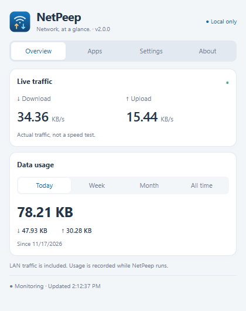

# NetPeep

A minimal cross-platform network monitor with live upload/download speeds, local usage history, per-app activity, selectable units and light/dark themes.

## Downloads

| Platform | Current file | Status |
| --- | --- | --- |
| Windows x64 | [Installer — 2.35 MB](downloads/NetPeep-2.0.0-Windows-x64-Setup.exe) | Native/WebView2 build; Windows-tested; unsigned |
| Windows x64 | [Portable ZIP — 368 KB](downloads/NetPeep-2.0.0-Windows-x64-Portable.zip) | Extract the entire ZIP; requires shared WebView2 |
| macOS Apple Silicon | [Desktop builds → Artifacts](https://github.com/mhsowrove/NetPeep-Internet-Speed-Monitor/actions/workflows/build.yml) | DMG/ZIP generated by a successful `macOS-arm64` job; development signing, not notarized |
| macOS Intel | [Desktop builds → Artifacts](https://github.com/mhsowrove/NetPeep-Internet-Speed-Monitor/actions/workflows/build.yml) | DMG/ZIP generated by a successful `macOS-x64` job; development signing, not notarized |

Quit older NetPeep versions before installing. macOS builds run on GitHub's actual Mac runners; no Mac binary or runtime validation was produced by the Windows workstation. See [macOS build details](MACOS.md) and [Windows requirements](WINDOWS.md).



[Dark settings preview](docs/images/settings-dark.png) · [About / donation preview](docs/images/about-light.png)

## Version 2.0 — compact UI and small Windows release

The Windows installer is now about **2.35 MB**, with a roughly **365 KB portable ZIP**, using the system Microsoft Edge WebView2 runtime instead of bundling Electron. The download no longer contains a complete browser. WebView2 and .NET Framework are runtime requirements; see **[Windows installation/build instructions](WINDOWS.md)** for details and source build commands.

The main window is about 420px wide with **Overview, Apps, Settings and About** tabs. **Settings → Units** offers Auto/B/KB/MB/GB, applied to live rates, usage, process rates and taskbar readings. **Settings → Theme** offers System/Light/Dark. Preferences persist locally. About includes v2.0.0, **MD SOWROVE HOSSAIN**, saved contact links and optional PayPal/bKash donations. The approved Wi-Fi + upload/download icon replaces the bird everywhere.

For Windows, use the new native installer or ZIP. `npm start` remains the shared Electron development/macOS host; Electron's Windows packaging commands are legacy alternatives and still produce a large download. macOS source is included but has not been validated on a Mac in this environment.

## Version 1.1 — transparent Windows taskbar meter

The Windows meter now matches the supplied reference: two stacked readings, upload above download, with a yellow up arrow and blue down arrow, white text, a transparent background, no frame and no shadow. It sits over the primary Windows taskbar before the notification area by default. Readings use bytes per second (B/s, decimal KB/s and MB/s).

To move it: right-click NetPeep's tray icon, choose **Unlock meter to move**, drag the readings to an empty taskbar section, then click the small checkmark or choose **Pin meter to taskbar**. The dashboard also has a **Pin to taskbar** checkbox. Position is saved and follows primary-taskbar size/DPI changes. Pinned readings are click-through so they do not intercept taskbar clicks. **Reset taskbar position** restores automatic placement. NetPeep uses the real native taskbar rectangle and notification-area rectangle; when the taskbar slides offscreen it hides the pinned meter on the next sample.

This is a transparent taskbar overlay, not an Explorer extension: it does not reserve space or move existing Windows icons. If your taskbar is crowded, unlock and place it in an empty section. Only the primary taskbar is supported. Automatic placement and pinning are Windows-specific; the macOS menu-bar indicator remains unchanged. The app must be running to show the meter; pinning does not install a startup service or enable launch at login.

A local desktop network monitor for Windows and macOS. Shared HTML/CSS/JavaScript UI, Windows WebView2/Electron macOS hosts, a network icon, native operating-system counters, live download/upload throughput, calendar usage history, process activity and tray/menu-bar meter. No accounts, app telemetry, external UI assets, data server, or speed-test traffic.

## Shared UI / Electron macOS development

Install Node.js 22 or newer and npm, then from this folder:

```sh
npm ci
npm test
npm start
```

The optional Electron Windows development host requires Windows PowerShell 5.1 and compiles its collector in memory with `Add-Type`. The new native Windows release compiles the collector into the app and does not invoke PowerShell at runtime. Neither Windows build needs administrator rights for adapter totals or normally for the active IPv4 TCP process table.

macOS uses `/usr/sbin/netstat` and `/usr/bin/nettop`, bundled with macOS. No Homebrew, Swift compiler or private framework is required. The macOS backend is source-complete but has not been executed on this Windows build host. Run the acceptance checks below on each target macOS version before distributing.

## Electron builds (macOS / legacy Windows alternative)

```sh
npm run pack       # unpacked app for current platform
npm run dist:win   # Windows portable executable; build on Windows
npm run dist:mac   # macOS DMG + ZIP; build on a Mac
```

Output goes in `release/`. The Windows unpacked build must be distributed with its entire folder, not just `NetPeep.exe`. The portable executable extracts its runtime on launch. These development builds are unsigned. For public distribution, supply your own platform signing credentials to electron-builder and notarize the macOS build with Apple credentials; no signing credentials are included. Build each desired architecture on its native runner (for example `npx electron-builder --mac --arm64` or `--x64`). Dependency versions are recorded in `package-lock.json`. The PNG/ICO/tray assets are included; on Windows `npm run icons` regenerates them using built-in drawing APIs. The SVG is editable source artwork.

## Everyday use

- **Overview:** measured bytes per second and calendar usage totals. This measures current traffic, not maximum connection speed or ISP performance.
- **Usage:** today, Monday-based calendar week, calendar month and all time since recording began. Both transferred directions are persisted by local date.
- **Measure:** auto sums likely physical active adapters. Select an individual adapter for VPNs, bridges, unusual hardware or to avoid double counting. Auto detection is a name/type heuristic, not a routing guarantee. A selected adapter disappearing produces zero new transferred bytes; reconnection starts a new baseline.
- **Process table:** native observations, sorted by available throughput then connection count. A dash means no valid byte observation. Processes are intentionally identified by name + PID, rather than guessed branded app names.
- **Taskbar meter:** transparent stacked upload/download readings; unlock from the tray menu to drag, then click the checkmark to pin. Pinned readings are click-through. Open the dashboard from the tray icon.
- **Tray:** open, toggle the meter, unlock/pin/reset its position, restart counters or quit. Closing the dashboard keeps collection running. Windows controls tray icon visibility; pin NetPeep's icon in Windows tray settings to keep controls easy to reach. Live numbers are visible directly over the taskbar without hovering. There is no taskbar injection/DeskBand.
- **Export:** save local daily totals and preferences as JSON. No export is sent anywhere.

## Measurement boundaries

Adapter traffic includes LAN transfers and interface/protocol overhead. It cannot establish which bytes traversed the public internet. VPN virtual and physical interfaces may account for the same traffic at different layers; selecting exactly one is recommended. Process numbers must not be summed and presented as an accurate breakdown of adapter totals.

**Windows:** interfaces use .NET `NetworkInterface.GetIPStatistics()`. Process ownership uses IP Helper `GetExtendedTcpTable`, IPv4 established TCP only. When NetPeep is explicitly launched as administrator, the collector enables `TcpConnectionEstatsData` for sampled connections and reads `DataBytesIn`/`DataBytesOut` through `GetPerTcpConnectionEStats`. It never prompts or elevates itself. Enabling a connection is followed by baselining; first observations do not count historical connection traffic. Collection is partial: UDP/QUIC, IPv6, short-lived connections between polls and connections whose EStats calls fail are absent. TCP data bytes include retransmissions and exclude TCP headers. It does not use misleading process disk-I/O counters. Even in administrator mode a process can show dashes when no eligible connection has two valid observations. Polling may miss bytes at connection closure or connection reuse. Unprivileged mode shows connection counts with byte fields unavailable. IP Helper error codes are surfaced instead of silently inventing zero process traffic. No packet payload, destination address or hostname is written to history.

**macOS:** interface counters come from `netstat -ibn` link rows, deduplicated by interface; aliases and loopback are excluded. Auto selects `enN` interfaces. `nettop -P -L 1 -x -J bytes_in,bytes_out` returns process counters, and NetPeep differences successive observations. First appearances are baselined. Visibility and permissions vary by macOS version; failure degrades to adapter totals and an explanatory status. Shared daemons, VPNs, helpers, PID reuse, exited processes and OS attribution semantics limit accuracy. No unsupported private NetworkStatistics API or network-extension entitlement is required. This is a best-effort system-tool integration, not a claim of App Store sandbox compatibility. Validate nettop output and permissions on the target Mac.

**Time/history:** collection runs only while NetPeep is open, including when the dashboard is hidden. No service is installed. The native Windows installer offers an optional, unchecked start-at-sign-in setting. There is no retroactive usage before first launch, while quit, or during sleep. Rates use monotonic elapsed time. Interface counter resets and vanished interfaces start new baselines. Gaps of 15 seconds or more are discarded to avoid counting ambiguous resume intervals. Samples crossing midnight are attributed to their arrival date. Daily history is not pruned; process samples are live only and not stored.

## Local data and reliability

`usage.json` lives in Electron's user data directory:

- Windows: `%APPDATA%\NetPeep\usage.json` (development name may be `netpeep`).
- macOS: `~/Library/Application Support/NetPeep/usage.json` (development name may be `netpeep`).

NetPeep writes every five seconds and on normal quit using a temporary file and atomic rename. Sudden power loss/termination can lose the latest five seconds. Corrupt history is copied to a timestamped `.corrupt-...` file before starting a fresh ledger; write errors appear in the UI. Remove the data file while the app is quit to reset history. Export first if you want a backup. Persistence is local, unencrypted and uses OS account filesystem protection. Concurrent app instances are prevented. There is no auto-update mechanism.

## Source map

- `src/main.js`: windows, tray, sampling lifecycle, suspend/resume, IPC and persistence scheduling.
- `src/core.js`: counter deltas, local calendar periods, data validation and atomic storage.
- `src/collectors.js`: subprocess lifecycle, JSON framing, macOS parsers and process deltas.
- `native/windows.cs` + `windows.ps1`: native Windows IP Helper and adapter collector.
- `src/app.html`, `app.css`, `app.js`: compact shared interface; `format.js`: selectable units; `native-bridge.js`: WebView2 messaging.
- `native/NativeApp.cs`: small Windows host, atomic ledger, tray and transparent taskbar drawing; `native/build.ps1`: native build; `native/NetPeep.iss`: installer.
- `src/compact.*`: Electron live-meter variant. Earlier dashboard sources remain for reference and are not used by the native build.
- `assets/`: original icon artwork and platform assets.
- `test/core.test.js`: deterministic counter, calendar, storage and parser checks.

The renderer has no Node integration, is sandboxed with context isolation, uses a narrow preload API, blocks navigation/new windows and external connections via CSP, and inserts process names as text. Privileged collectors never receive shell commands or user-generated process names as command arguments.

## Acceptance checks

1. Run `npm test`. Launch on Windows normally: adapter rates and process connection counts should populate; per-app bytes should be dashes.
2. Make a known LAN or internet transfer; confirm download/upload direction and approximate bytes against the chosen interface's OS counters, allowing for overhead.
3. Quit normally and relaunch; daily/all-time usage should remain. Export and compare the ledger. Periods use local dates; a week starts Monday.
4. Switch adapters, disconnect/reconnect, sleep/resume and restart counters. No historical interface lifetime count should be added and stale readings should become unavailable.
5. Check the tray menu, dashboard close/reopen, floating meter drag/toggle and keyboard navigation. Test Windows tray overflow behavior and macOS menu bar appearance separately.
6. On a trusted Windows test setup, launch as administrator and transfer over a long-lived IPv4 TCP connection. Allow three polls to enable/baseline; partial per-process byte rates should appear. UDP/QUIC and IPv6-only processes should not acquire invented byte rates.
7. On macOS, inspect `nettop` output and test known process transfers, permission denial and shared-daemon attribution. Run both Intel and Apple Silicon builds if shipping both.
8. Validate signed/notarized release artifacts on clean target machines before public distribution.

See `VALIDATION.md` for checks actually performed here. MIT licensed; bundled Electron/Chromium dependencies retain their own licenses.
